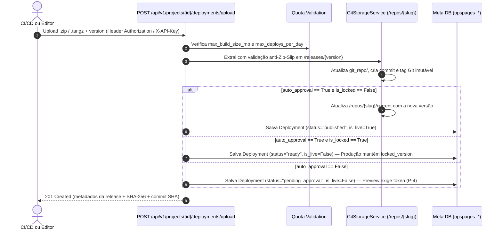

> Language: pt-BR
>
> Status: ACCEPTED
>
> Documentation Standard v1.0 (Loft AIOps)

# Level 2 — Arquitetura e Fluxos Gerais (`architecture/overview.md`)

## 1. Diagrama de Containers (C4 Nível 2)

```mermaid
flowchart TB
    subgraph Actors["Atores & Consumidores"]
        Dev["Engenheiro / Admin (Browser :5176)"]
        CICD["GitHub Actions / Pipeline CI/CD"]
        Visitor["Usuário Final (Browser /pages/{slug})"]
    end

    subgraph OpsPages["AIOps OpsPages Platform"]
        UI["Frontend Console React + Vite (:5176)\nRotas URL + Paginação >= 10 + Copan Themes"]
        API["FastAPI Control Plane (:8005/api/v1)\nAuth JWT/API-Key + HBAC + Quotas + Audit"]
        StaticEngine["Static & Preview Hosting Engine (:8005/pages/*)\nCSP + CORS Exato + Cache-Control + ETag 304 + env-config.js"]
        GitEngine["Git Storage Service\n/repos/{slug}/git_repo + /releases/{ver} + /current"]
    end

    subgraph Storage["Persistência & Ecossistema Externo"]
        MetaDB[("Meta DB SQLAlchemy 2.0\nSQLite / PostgreSQL / MariaDB")]
        ReposFS[("Filesystem /repos/{slug}\nSnapshots Imutáveis & Tags Git")]
        GitHub["GitHub Remote Repo\n(/repos/{slug})"]
        OpsBase["AIOps OpsBase (:8000)\nBackend BaaS / Dados Dinâmicos"]
    end

    Dev -->|HTTPS / REST JWT| UI
    UI -->|Proxy /api/v1 & /pages| API
    CICD -->|POST /deployments/upload\nHeader X-API-Key| API
    Visitor -->|GET /pages/{slug}/\nGET /pages/{slug}/env-config.js| StaticEngine
    Visitor -->|Consome API com opsbase_anon_key| OpsBase

    API --> MetaDB
    API --> GitEngine
    StaticEngine --> MetaDB
    StaticEngine --> ReposFS
    GitEngine --> ReposFS
    GitEngine <-->|git push / pull| GitHub
```

---

## 2. Estrutura Física do Diretório `/repos/{slug}` (`Confirmed`)

Cada projeto criado no OpsPages provisiona automaticamente a seguinte árvore isolada em disco (gerenciada por [`GitStorageService`](../../backend/app/services/git_storage.py)):

```text
repos/
└── {project-slug}/
    ├── git_repo/                  # Repositório Git real (git init -b main)
    │   ├── .git/                  # Histórico de commits e tags semânticas (v1.0.0, 1.1.0...)
    │   ├── .opspages-manifest.json# Metadados assinados da release (SHA-256, autor, timestamp)
    │   └── ...                    # Árvore de arquivos da última build commitada
    ├── releases/                  # Snapshots imutáveis por versão (permite preview e rollback instantâneo)
    │   ├── 1.0.0/
    │   └── 1.1.0/
    ├── sources/                   # Pacotes opcionais de código-fonte TypeScript por versão
    │   ├── 1.0.0/
    │   └── 1.1.0/
    └── current/                   # Cópia ativa em produção servida em /pages/{slug}/
```

---

## 3. Fluxo de Publicação, Aprovação e Version Lock (`Confirmed`)



---

## 4. Fluxo de Requisição Estática, Cache e Injeção Pública (`P-1` a `P-13`)

1. **Validação de Token na Query String (`P-8`)**: Se a URL contiver `?token=`, `?access_token=` ou `?api_key=`, o middleware retorna imediatamente `401 Unauthorized`.
2. **Controle de Acesso ao Preview (`P-4`)**: Em `/pages/{slug}/v/{version}`, se a versão estiver em `pending_approval`, `rejected` ou `failed` (ou se o projeto for privado), o servidor exige token válido via header (`Authorization` ou `X-API-Key`).
3. **Endpoints Dinâmicos de Configuração Pública (`P-13`)**:
   - `GET /pages/{slug}/env-config.js` e `GET /pages/{slug}/env-config.json` retornam a configuração pública ativa do ambiente (`opsbase_url`, `opsbase_anon_key`, `public_vars`).
4. **Resolução de Arquivos e Fallback Pós-Rollback (`P-3` & `P-5`)**:
   - Na rota `/pages/{slug}/v/{version}/`, referências absolutas `/pages/{slug}/assets/...` no HTML/JS/CSS são reescritas para `/pages/{slug}/v/{version}/assets/...`.
   - Caso um navegador solicite um asset hasheado `/assets/*` de uma versão anterior logo após um rollback, `_resolve_static_file` localiza o asset imutável em `/repos/{slug}/releases/*`, evitando tela em branco (`404`).
5. **Requisições Condicionais (`P-7`)**: Calcula `ETag` e `Last-Modified`; se `If-None-Match` ou `If-Modified-Since` coincidir, responde `304 Not Modified` sem trafegar corpo.
6. **Headers de Segurança (`P-2`), Cache (`P-1`) e CORS Exato (`P-9`)**:
   - `index.html` e `env-config.js`: `Cache-Control: no-cache, max-age=0, must-revalidate`.
   - `/assets/*`: `Cache-Control: public, max-age=31536000, immutable`.
   - `Content-Security-Policy`, `X-Content-Type-Options: nosniff`, `X-Frame-Options`, `Referrer-Policy`, `Strict-Transport-Security` e `Vary: Origin`.
