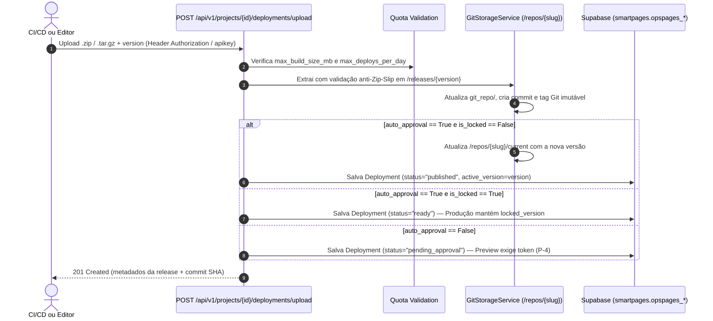

> Language: pt-BR
>
> Status: ACCEPTED
>
> Documentation Standard v1.0 (Olivelas)

# Level 2 — Arquitetura e Fluxos Gerais (`architecture/overview.md`)

## 1. Diagrama de Containers (C4 Nível 2)

```mermaid
flowchart TB
    subgraph Actors["Atores & Consumidores"]
        Dev["Engenheiro / Global Admin\n(GitHub Pages ou Browser :5176)"]
        CICD["GitHub Actions / Pipeline CI/CD"]
        Visitor["Usuário Final\n(Browser /pages/{slug})"]
    end

    subgraph OpsPages["Olivelas SmartPages Platform"]
        UI["Frontend Console React + Vite\n(GitHub Pages / :5176 + supabaseBridge.ts)"]
        API["FastAPI Control Plane (:8005/api/v1)\nAuth JWT/API-Key + HBAC + Quotas + Audit"]
        StaticEngine["Static & Preview Hosting Engine (:8005/pages/*)\nCSP + CORS Exato + Cache-Control + ETag 304 + env-config.js"]
        GitEngine["Git Storage Service\n/repos/{slug}/git_repo + /releases/{ver} + /current"]
    end

    subgraph Storage["Persistência & Ecossistema Externo"]
        Supabase[("Supabase PostgreSQL\nSchema Isolado: smartpages\n15 Tabelas + RPCs + Triggers")]
        ReposFS[("Filesystem /repos/{slug}\nSnapshots Imutáveis & Tags Git")]
        GitHub["GitHub Remote Repo\n(pycriador/olivelas-smartpages)"]
        OpsBase["Olivelas OpsBase (:8001)\nBackend BaaS / Dados Dinâmicos"]
    end

    Dev -->|HTTPS| UI
    UI -->|REST /api/v1| API
    UI -->|PostgREST / RPC\nAccept-Profile: smartpages| Supabase
    CICD -->|POST /deployments/upload\nHeader apikey / X-API-Key| API
    Visitor -->|GET /pages/{slug}/\nGET /pages/{slug}/env-config.js| StaticEngine
    Visitor -->|Consome API com opsbase_anon_key| OpsBase

    API --> Supabase
    API --> GitEngine
    StaticEngine --> Supabase
    StaticEngine --> ReposFS
    GitEngine --> ReposFS
    GitEngine <-->|git push / pull| GitHub
```

---

## 2. Isolamento no Schema `smartpages` do Supabase (`Confirmed`)

Toda a persistência de dados opera estritamente no schema **`smartpages`** do Supabase PostgreSQL:
- **Backend FastAPI**: Configura `options="-c search_path=smartpages,public,extensions"` e listener `SET search_path TO smartpages, public, extensions` em todas as conexões SQLAlchemy ([`backend/app/db/session.py`](../../backend/app/db/session.py)).
- **Frontend (GitHub Pages)**: Envia os cabeçalhos `Accept-Profile: smartpages` e `Content-Profile: smartpages` em todas as chamadas PostgREST e `/rest/v1/rpc/*` ([`frontend/src/services/supabaseBridge.ts`](../../frontend/src/services/supabaseBridge.ts)).
- **Seed Inicial Limpo**: Popula exclusivamente 5 configurações da plataforma (`opspages_platform_settings`), 20 temas visuais (`opspages_themes`) e 3 grupos HBAC (`opspages_groups`). As tabelas `opspages_users` e `opspages_projects` iniciam com `0` linhas para que o primeiro usuário registrado torne-se automaticamente o **Global Admin**.

---

## 3. Estrutura Física do Diretório `/repos/{slug}` (`Confirmed`)

Cada projeto criado no Backend provisiona automaticamente a seguinte árvore isolada em disco (gerenciada por [`GitStorageService`](../../backend/app/services/git_storage_service.py)):

```text
repos/
└── {project-slug}/
    ├── git_repo/                  # Repositório Git real (git init -b main)
    │   ├── .git/                  # Histórico de commits e tags semânticas (v1.0.0, 1.1.0...)
    │   ├── .opspages-release.json # Metadados assinados da release (autor, timestamp, tamanho)
    │   └── ...                    # Árvore de arquivos da última build commitada
    ├── releases/                  # Snapshots imutáveis por versão (permite preview e rollback instantâneo)
    │   ├── 1.0.0/
    │   └── 1.1.0/
    ├── source/                    # Pacotes opcionais de código-fonte TypeScript por versão
    │   ├── 1.0.0/
    │   └── 1.1.0/
    └── current/                   # Cópia ativa em produção servida em /pages/{slug}/
```

---

## 4. Fluxo de Publicação, Aprovação e Version Lock (`Confirmed`)


