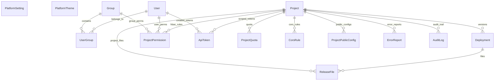

> Language: pt-BR
>
> Status: ACCEPTED
>
> Documentation Standard v1.0 (Olivelas)

# Level 3 — Modelo de Dados (`contracts/data-model.md`)

O banco de metadados do **Olivelas SmartPages (`Olivelas OpsPages`)** é definido em [`backend/app/models/meta_models.py`](../../backend/app/models/meta_models.py) e nas migrations SQL de [`supabase/migrations/`](../../supabase/migrations/), operando de forma isolada no schema **`smartpages`** do Supabase PostgreSQL (além de suportar SQLite e MariaDB/MySQL via SQLAlchemy 2.0).

---

## 1. Diagrama Entidade-Relacionamento (ERD — Schema `smartpages`)

---

## 2. Catálogo das 15 Tabelas no Schema `smartpages` (`Confirmed`)

| Tabela Física (`smartpages.*`) | Classe ORM | Chave Primária | Estado Inicial (Seed) | Propósito |
| :--- | :--- | :---: | :---: | :--- |
| `opspages_platform_settings` | `PlatformSetting` | `key` | **5 registros** | Identidade da plataforma (`Olivelas SmartPages`), aparência padrão, política de 1º usuário Global Admin, quotas e CORS/CSP padrão |
| `opspages_themes` | `PlatformTheme` | `id` | **20 temas** | Catálogo oficial de temas visuais (10 Light + 10 Dark, incluindo `Olivelas Obsidian` e `Olivelas Classic`) |
| `opspages_groups` | `Group` | `id` | **3 grupos** | Grupos HBAC (`Platform Admins`, `Frontend Editors`, `Project Viewers`) e `role_level` |
| `opspages_users` | `User` | `id` | **0 registros** | Contas de usuários (`username`, `email`, `hashed_password`, `is_superuser`, `preferred_theme`, `preferred_language`). **O 1º cadastro torna-se Global Admin** |
| `opspages_user_groups` | *(Association)* | `(user_id, group_id)` | **0 registros** | Associação N:N entre usuários e grupos HBAC |
| `opspages_projects` | `Project` | `id` | **0 registros** | Projetos estáticos, estado Git, `active_version`, `is_locked`, cache (`P-1`) e security headers (`P-2`) |
| `opspages_project_permissions` | `ProjectPermission` | `id` | **0 registros** | Regras HBAC específicas por projeto para usuário ou grupo (`admin`, `editor`, `viewer`) |
| `opspages_deployments` | `Deployment` | `id` | **0 registros** | Releases versionadas (`version`, `status`, `git_commit_sha`, `git_tag`, `file_count`, `size_bytes`) |
| `opspages_release_files` | `ReleaseFile` | `id` | **0 registros** | Artefatos e arquivos das releases persistidos no banco para exploração e preview no GitHub Pages |
| `opspages_api_tokens` | `ApiToken` | `id` | **0 registros** | Tokens de API/CI-CD com hash SHA-256 (`token_prefix`, `key_hash`, `scopes`) |
| `opspages_project_quotas` | `ProjectQuota` | `id` | **0 registros** | Quotas por projeto (`max_build_size_mb`, `max_storage_mb`, `max_deploys_per_day`, `max_retained_versions`) |
| `opspages_cors_rules` | `CorsRule` | `id` | **0 registros** | Regras de CORS por projeto (`origin`, `allowed_methods`, `allowed_headers`, `allow_credentials`) |
| `opspages_public_configs` | `ProjectPublicConfig` | `id` | **0 registros** | Credenciais públicas por ambiente (`environment`, `opsbase_url`, `opsbase_public_key`, `opsbase_rls_enforced`, `public_vars_json`) (`P-13`, `P-24`) |
| `opspages_error_reports` | `ErrorReport` | `id` | **0 registros** | Relatos de erros enviados via `/errors` ou `/api/v1/errors/report` |
| `opspages_audit_logs` | `AuditLog` | `id` | **0 registros** | Trilha imutável de auditoria forense com `diff_payload`, `actor_email`, `ip_address` e `timestamp` |

---

## 3. Triggers de Banco para o 1º Cadastro Global Admin (`Confirmed`)

Definidas em [`supabase/migrations/20261107000001_init_smartpages_schema.sql`](../../supabase/migrations/20261107000001_init_smartpages_schema.sql):
1. **`trg_before_user_insert_global_admin`**: Antes de qualquer `INSERT` em `smartpages.opspages_users`, verifica se a tabela está vazia (`NOT EXISTS (SELECT 1 FROM smartpages.opspages_users)`). Se estiver vazia, define automaticamente `NEW.is_superuser := TRUE` e `NEW.is_active := TRUE`.
2. **`trg_after_user_insert_assign_group`**: Após o `INSERT`, vincula automaticamente o usuário superadmin ao grupo `Platform Admins` (`role_level = 'admin'`) e grava o evento `BOOTSTRAP_GLOBAL_ADMIN` em `smartpages.opspages_audit_logs`.
