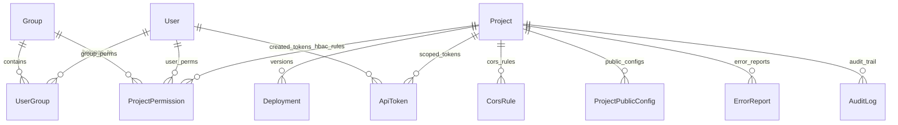

> Language: pt-BR
>
> Status: ACCEPTED
>
> Documentation Standard v1.0 (Loft AIOps)

# Level 3 — Modelo de Dados (`contracts/data-model.md`)

O banco de metadados do **AIOps OpsPages** é definido em [`backend/app/models/meta_models.py`](../../backend/app/models/meta_models.py) utilizando **SQLAlchemy 2.0** e suporta **SQLite**, **PostgreSQL** e **MariaDB/MySQL**.

---

## 1. Diagrama Entidade-Relacionamento (ERD)

---

## 2. Catálogo de Tabelas (`Confirmed`)

| Tabela Física | Classe ORM | Chave Primária | Propósito |
| :--- | :--- | :---: | :--- |
| `opspages_users` | `User` | `id` | Usuários da plataforma (`username`, `email`, `hashed_password`, `is_superuser`) |
| `opspages_groups` | `Group` | `id` | Grupos HBAC (`Platform Admins`, `Frontend Editors`, `Project Viewers`) e `role_level` |
| `opspages_user_groups` | *(Association)* | `(user_id, group_id)` | Associação N:N entre usuários e grupos |
| `opspages_projects` | `Project` | `id` | Projetos estáticos, estado Git, `active_version`, `is_locked`, quotas, cache (`P-1`) e security headers (`P-2`) |
| `opspages_project_permissions` | `ProjectPermission` | `id` | Regras HBAC específicas por projeto para um usuário ou grupo (`admin`, `editor`, `viewer`) |
| `opspages_deployments` | `Deployment` | `id` | Releases versionadas (`version`, `status`, `git_commit_sha`, `git_tag`, `archive_sha256`, `is_live`) |
| `opspages_api_tokens` | `ApiToken` | `id` | Tokens de API/CI-CD armazenados apenas por hash SHA-256 (`token_prefix`, `token_hash`, `scope`) |
| `opspages_cors_rules` | `CorsRule` | `id` | Regras de CORS por projeto (`allowed_origin`, `allow_methods`, `allow_headers`, `allow_credentials`) |
| `opspages_public_configs` | `ProjectPublicConfig` | `id` | Credenciais públicas por ambiente (`environment`, `opsbase_url`, `opsbase_anon_key`, `public_vars_json`) (`P-13`) |
| `opspages_error_reports` | `ErrorReport` | `id` | Relatos de erros enviados via `/errors` ou `/api/v1/errors` (`page_url`, `route_path`, `severity`, `status`) |
| `opspages_audit_logs` | `AuditLog` | `id` | Trilha imutável de auditoria forense com `diff_json`, `actor_email`, `ip_address` e `created_at` |
