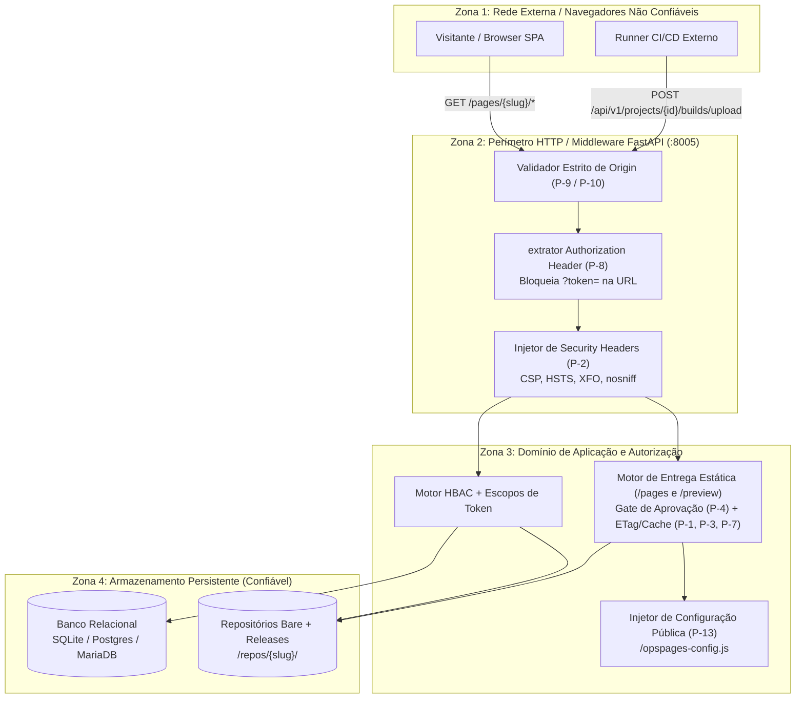

> **Language:** pt-BR
> **Status:** ACCEPTED
> **Documentation Standard v1.0 (Loft AIOps)**

# Fronteiras de Confiança e Modelo de Ameaças (Nível 5)

## 1. Diagrama de Fronteiras de Confiança (Trust Boundaries)

---

## 2. Análise de Ameaças (STRIDE) e Mitigações

| ID | Ameaça (STRIDE) | Vetor de Ataque | Mitigação Implementada | Evidência no Código |
| :--- | :--- | :--- | :--- | :--- |
| **TM-01** | **Information Disclosure** (Vazamento de Token) | Passagem de token via query string (`?token=...`) exposta em logs de proxy reverso, histórico do navegador e header `Referer`. | Rejeição explícita com `HTTP 401` sempre que `?token=` estiver presente na URL (`P-8`). Aceitação restrita ao header `Authorization: Bearer`. | [`backend/app/core/deps.py`](file:///Users/willian.jesus/Downloads/aiops-opspages/backend/app/core/deps.py) |
| **TM-02** | **Spoofing / Cross-Origin Data Theft** | Site malicioso (`https://evil.example.org`) realiza requisição autenticada (`credentials: 'include'`) explorando CORS permissivo. | Validação exata de origem contra `ALLOWED_ORIGINS` (API) ou `cors_rules` do projeto (`P-9`, `P-10`). Proibição de `*` com `Allow-Credentials: true` e adição obrigatória de `Vary: Origin`. | [`backend/app/main.py`](file:///Users/willian.jesus/Downloads/aiops-opspages/backend/app/main.py) e [`backend/app/api/routes/pages_server.py`](file:///Users/willian.jesus/Downloads/aiops-opspages/backend/app/api/routes/pages_server.py) |
| **TM-03** | **Elevation of Privilege / Acesso Precoce** | Acesso público a builds em `/preview/{slug}/{version}/` antes da revisão/aprovação de segurança. | Gate de aprovação (`P-4`): builds não publicados (`pending_approval`, `rejected`, `archived`) exigem header `Authorization: Bearer` válido. | [`backend/app/api/routes/pages_server.py`](file:///Users/willian.jesus/Downloads/aiops-opspages/backend/app/api/routes/pages_server.py) |
| **TM-04** | **Information Disclosure** (Enumeração Pública) | Coleta de e-mails de administradores e caminhos físicos do servidor via `/api/v1/public/overview`. | Sanitização completa do payload público (`P-11`), retornando apenas metadados públicos de projetos e contadores agregados. | [`backend/app/api/routes/audit.py`](file:///Users/willian.jesus/Downloads/aiops-opspages/backend/app/api/routes/audit.py) |
| **TM-05** | **Tampering** (Zip Slip / Path Traversal) | Upload de pacote `.zip` contendo entradas `../../etc/passwd` ou leitura de `../../opspages_meta.db` na rota estática. | Validação de `.resolve()` restrita ao diretório raiz da release tanto na extração de ZIP quanto no servidor de arquivos estáticos. | [`backend/app/services/git_storage.py`](file:///Users/willian.jesus/Downloads/aiops-opspages/backend/app/services/git_storage.py) |
| **TM-06** | **Information Disclosure** (Credenciais Hardcoded no Bundle) | Gravação de chaves de API diretamente no código compilado da SPA. | Injeção em runtime via endpoint `/pages/{slug}/opspages-config.js` e `/.well-known/opspages-config.json` (`P-13`) com chaves públicas de escopo restrito por ambiente. | [`backend/app/api/routes/projects.py`](file:///Users/willian.jesus/Downloads/aiops-opspages/backend/app/api/routes/projects.py) |
