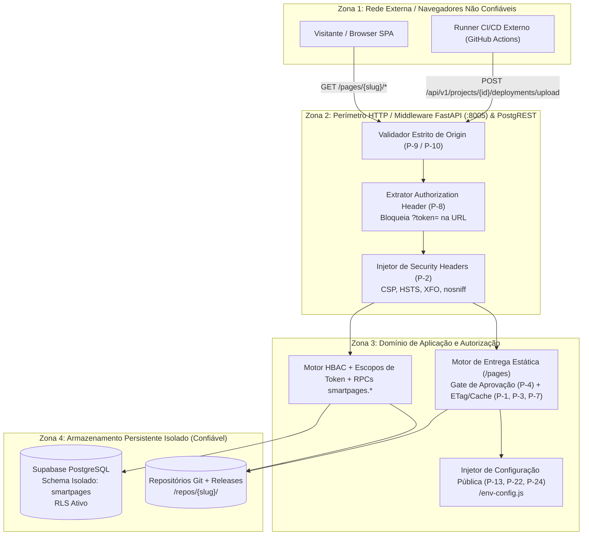

> **Language:** pt-BR
> **Status:** ACCEPTED
> **Documentation Standard v1.0 (Olivelas)**

# Fronteiras de Confiança e Modelo de Ameaças (Nível 5)

## 1. Diagrama de Fronteiras de Confiança (Trust Boundaries)

---

## 2. Análise de Ameaças (STRIDE) e Mitigações

| ID | Ameaça (STRIDE) | Vetor de Ataque | Mitigação Implementada | Evidência no Código |
| :--- | :--- | :--- | :--- | :--- |
| **TM-01** | **Information Disclosure** (Vazamento de Token) | Passagem de token via query string (`?token=...`) exposta em logs de proxy reverso, histórico do navegador e header `Referer`. | Rejeição explícita com `HTTP 401` sempre que `?token=`, `?access_token=` ou `?api_key=` estiver presente na URL (`P-8`). | [`backend/app/services/auth_service.py`](../../backend/app/services/auth_service.py) |
| **TM-02** | **Spoofing / Cross-Origin Data Theft** | Site malicioso (`https://evil.example.org`) realiza requisição autenticada (`credentials: 'include'`) explorando CORS permissivo. | Validação exata de origem contra `CORS_ORIGINS` (API) ou `cors_rules` do projeto (`P-9`, `P-10`). Proibição de `*` com `Allow-Credentials: true` e adição obrigatória de `Vary: Origin`. | [`backend/app/main.py`](../../backend/app/main.py) |
| **TM-03** | **Elevation of Privilege / Acesso Precoce** | Acesso público a builds em `/pages/{slug}/v/{version}/` antes da revisão/aprovação de segurança. | Gate de aprovação (`P-4`): builds não publicados (`pending_approval`, `rejected`, `failed`) exigem header de autenticação válido. | [`backend/app/main.py`](../../backend/app/main.py) |
| **TM-04** | **Information Disclosure** (Enumeração Pública) | Coleta de e-mails de administradores e caminhos físicos do servidor via `/api/v1/public/overview`. | Sanitização completa do payload público (`P-11`) para requisições não autenticadas. | [`backend/app/main.py`](../../backend/app/main.py) |
| **TM-05** | **Tampering** (Zip Slip / Path Traversal) | Upload de pacote `.zip` contendo entradas `../../etc/passwd` ou leitura de `../../` na rota estática. | Validação de `.resolve()` restrita ao diretório raiz da release tanto na extração de ZIP quanto no servidor de arquivos estáticos. | [`backend/app/services/deployment_service.py`](../../backend/app/services/deployment_service.py) e [`backend/app/main.py`](../../backend/app/main.py) |
| **TM-06** | **Tampering / Cross-Schema Contamination** | Colisão de tabelas com outros projetos que compartilham a mesma instância Supabase. | Isolamento total no schema `smartpages` (`search_path=smartpages,public,extensions` e `Accept-Profile: smartpages`). | [`supabase/migrations/20261107000001_init_smartpages_schema.sql`](../../supabase/migrations/20261107000001_init_smartpages_schema.sql) |
| **TM-07** | **Denial of Service** (Tempestade de Logins contra OpsBase) | Credencial desatualizada disparando dezenas de tentativas de login por segundo contra o OpsBase. | Backoff exponencial em memória por URL base (`30s` até `300s`, `P-22`), interrompendo novas tentativas imediatamente após falha `401`/`429`. | [`backend/app/services/opsbase_service.py`](../../backend/app/services/opsbase_service.py) |
